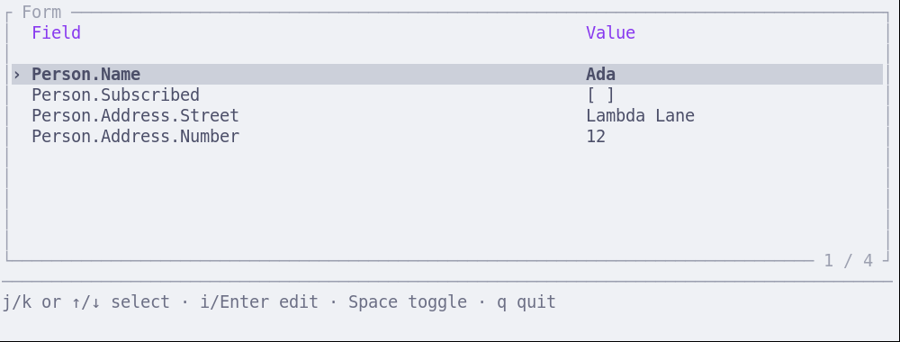

#+title: Typed forms using dependent types
#+subtitle: Session 1
#+author: Jan Mas Rovira
#+date: 2026-10-22
#+options: toc:nil num:nil H:1
#+latex_class: beamer
#+latex_class_options: [aspectratio=169]
#+latex_compiler: xelatex
#+latex_header: \usepackage{fontspec}
#+latex_header: \usepackage{listings}
#+latex_header: \usepackage{newunicodechar}
#+latex_header: \newunicodechar{←}{\ensuremath{\leftarrow}}
#+latex_header: \newunicodechar{⇒}{\ensuremath{\Rightarrow}}
#+latex_header: \newunicodechar{→}{\ensuremath{\rightarrow}}
#+latex_header: \newunicodechar{⟶}{\ensuremath{\longrightarrow}}
#+latex_header: \newunicodechar{⟨}{\ensuremath{\langle}}
#+latex_header: \newunicodechar{⟩}{\ensuremath{\rangle}}
#+latex_header: \newunicodechar{≤}{\ensuremath{\leq}}
#+latex_header: \newunicodechar{∧}{\ensuremath{\land}}
#+latex_header: \newunicodechar{α}{\ensuremath{\alpha}}
#+latex_header: \newunicodechar{≃}{\ensuremath{\simeq}}
#+latex_header: \lstset{literate={←}{{$\leftarrow$}}1 {⇒}{{$\Rightarrow$}}1 {→}{{$\rightarrow$}}1 {⟶}{{$\longrightarrow$}}2 {⟨}{{$\langle$}}1 {⟩}{{$\rangle$}}1 {≤}{{$\leq$}}1 {∧}{{$\land$}}1 {α}{{$\alpha$}}1 {≃}{{$\simeq$}}1}
#+latex_header: \definecolor{codeBackground}{HTML}{F5F7FA}
#+latex_header: \definecolor{codeBorder}{HTML}{CDD5DF}
#+latex_header: \definecolor{leanKeyword}{HTML}{3454A5}
#+latex_header: \definecolor{leanType}{HTML}{137C80}
#+latex_header: \definecolor{leanString}{HTML}{A35416}
#+latex_header: \definecolor{languageCostInherited}{HTML}{1B6B3A}
#+latex_header: \definecolor{languageCostPartial}{HTML}{7B3FA1}
#+latex_header: \definecolor{languageCostSpecific}{HTML}{A32929}
#+latex_header: \newcommand{\languageCost}[2]{#2}
#+latex_header: \newcommand{\coloredLanguageCost}[2]{\textcolor{languageCost#1}{#2}}
#+latex_header: \lstdefinelanguage{Lean}{morekeywords={def,abbrev,inductive,structure,class,where,deriving,match,with,theorem,by,decide,do,let,instance,forall},morekeywords=[2]{DataType,Widget,Form,Path,Expr,Type,Prop,Sort,Fin,String,Bool,Nat,Date,PlainDate,Json,Repr,DecidableEq,Except,Enum,FinEnum,AddressKind,AddressField},morekeywords=[3]{text,boolean,natural,date,enum,record,field,group,self,textInput,checkbox,naturalInput,dateInput,select},sensitive=true,morestring=[b]",morecomment=[l]{--}}
#+latex_header: \lstset{basicstyle=\ttfamily\small,keywordstyle=\color{leanKeyword}\bfseries,keywordstyle=[2]\color{leanType},keywordstyle=[3]\color{leanType},stringstyle=\color{leanString},commentstyle=\color{gray},showstringspaces=false,columns=fullflexible,keepspaces=true,breaklines=true,frame=single,rulecolor=\color{codeBorder},backgroundcolor=\color{codeBackground},framerule=0.5pt,framesep=6pt,xleftmargin=7pt,xrightmargin=7pt,aboveskip=8pt,belowskip=10pt}
#+latex_header: \setbeamertemplate{navigation symbols}{}

* An example form
:properties:
:beamer_opt: fragile
:end:
#+begin_export latex
\begin{lstlisting}
$> forms person
\end{lstlisting}
#+end_export
Screenshot: 

* Desiderata
- *Declarative forms*: describe the data, widgets and behaviour.
- *Type-safe definitions*: catch invalid field references, mismatched widgets and
  ill-typed expressions at compile time.
- *Typed results*: validate user input where the type is the SST.

* Architecture
#+attr_latex: :width \textwidth :height 0.75\textheight :options keepaspectratio
[[file:assets/architecture.pdf]]

* Describe a single text field in Lean
#+begin_center
A form with a single text field with no constraints
#+end_center

#+begin_export latex
\pause{}
\begin{columns}[c,onlytextwidth]
\begin{column}{0.61\textwidth}
\small
\lstset{basicstyle=\ttfamily\scriptsize}
#+end_export

#+begin_src lean
def nameType : DataType := .text

def nameForm : Form nameType nameType :=
  .field "Name" .textInput

def initial : String := "Ada"
#+end_src

#+begin_export latex
\end{column}
\begin{column}{0.36\textwidth}
\centering
\includegraphics[width=\linewidth]{assets/architecture-step1.pdf}
\end{column}
\end{columns}
#+end_export

* Lean sends the form to the client
:properties:
:beamer_opt: fragile
:end:
#+begin_export latex
\begin{columns}[c,onlytextwidth]
\begin{column}{0.61\textwidth}
\small
\lstset{basicstyle=\ttfamily\scriptsize}
#+end_export

#+begin_export latex
\begin{lstlisting}[basicstyle=\ttfamily\scriptsize]
{
  "form": {
    "kind": "field",
    "label": "Name",
    "widget": "textInput"
  },
  "schema": {
    "kind": "text"
  },
  "value": "Ada",
  "version": 1
}
\end{lstlisting}
#+end_export

#+begin_export latex
\end{column}
\begin{column}{0.36\textwidth}
\centering
\includegraphics[width=\linewidth]{assets/architecture-step2.pdf}
\end{column}
\end{columns}
#+end_export

* Rust renders the form and handles edits
#+begin_export latex
\begin{columns}[t,onlytextwidth]
\begin{column}{0.49\textwidth}
\centering
\small Before editing\par\medskip
\includegraphics[width=\linewidth]{assets/name-form-before.png}
\end{column}
\begin{column}{0.49\textwidth}
\centering
\small Editing the value\par\medskip
\includegraphics[width=\linewidth]{assets/name-form-editing.png}
\end{column}
\end{columns}
\par\vspace{0.5cm}
\centering
\includegraphics[width=0.48\textwidth]{assets/architecture-step3.pdf}
#+end_export

* The client sends the edited value to Lean
:properties:
:beamer_opt: fragile
:end:
#+begin_export latex
\begin{columns}[c,onlytextwidth]
\begin{column}{0.61\textwidth}
\small
\lstset{basicstyle=\ttfamily\scriptsize}
#+end_export
The response is a JSON value:

#+begin_export latex
\begin{lstlisting}
"Grace"
\end{lstlisting}
#+end_export

#+begin_export latex
\end{column}
\begin{column}{0.36\textwidth}
\centering
\includegraphics[width=\linewidth]{assets/architecture-step4.pdf}
\end{column}
\end{columns}
#+end_export

* JSON to String
:properties:
:beamer_opt: fragile
:end:
#+begin_export latex
\begin{columns}[c,onlytextwidth]
\begin{column}{0.61\textwidth}
\small
\lstset{basicstyle=\ttfamily\scriptsize}
#+end_export
Parse the JSON response and decode it.

#+begin_export latex
\begin{lstlisting}
("Grace" : Json.Value) ⇒ ("Grace" : String)
\end{lstlisting}
#+end_export

#+begin_export latex
\end{column}
\begin{column}{0.36\textwidth}
\centering
\includegraphics[width=\linewidth]{assets/architecture-step5.pdf}
\end{column}
\end{columns}
#+end_export

* Example: A date field
#+begin_center
A form with a single *valid* date field
#+end_center

* The Date type
#+begin_export latex
\lstset{basicstyle=\ttfamily\scriptsize}
#+end_export
From Lean standard library:

#+begin_src lean
structure PlainDate where
  year : Year.Offset
  month : Month.Ordinal
  day : Day.Ordinal
  valid : Year.Offset.Valid year month day
#+end_src

\pause{}

We add year bounds:

#+begin_src lean
structure Date where
  val : Std.Time.PlainDate
  withinBounds : 1 ≤ val.year ∧ val.year ≤ 9999
#+end_src

* Describe a single date field in Lean
#+begin_export latex
\begin{columns}[c,onlytextwidth]
\begin{column}{0.61\textwidth}
\small
\lstset{basicstyle=\ttfamily\scriptsize}
#+end_export
#+begin_src lean
def dateType : DataType := .date

def dateForm : Form dateType dateType :=
  .field "Date" .dateInput

def initial : Date :=
  { val := { year := 2028, month := 2, day := 28,
             valid := by decide }
    withinBounds := by decide }
#+end_src

#+begin_export latex
\end{column}
\begin{column}{0.36\textwidth}
\centering
\includegraphics[width=\linewidth]{assets/architecture-step1.pdf}
\end{column}
\end{columns}
#+end_export

* Lean sends the date form to the client
:properties:
:beamer_opt: fragile
:end:
#+begin_export latex
\begin{columns}[c,onlytextwidth]
\begin{column}{0.61\textwidth}
\small
\lstset{basicstyle=\ttfamily\scriptsize}
\begin{lstlisting}[basicstyle=\ttfamily\scriptsize]
{
  "form": {
    "kind": "field",
    "label": "Date",
    "widget": "dateInput"
  },
  "schema": {
    "kind": "date"
  },
  "value": "2028-02-28",
  "version": 1
}
\end{lstlisting}
\end{column}
\begin{column}{0.36\textwidth}
\centering
\includegraphics[width=\linewidth]{assets/architecture-step2.pdf}
\end{column}
\end{columns}
#+end_export

* Rust renders the date form and handles edits
#+begin_export latex
\begin{columns}[t,onlytextwidth]
\begin{column}{0.49\textwidth}
\centering
\small Before editing\par\medskip
\includegraphics[width=\linewidth]{assets/date-form-before.png}
\end{column}
\begin{column}{0.49\textwidth}
\centering
\small Selecting date \par\medskip
\includegraphics[width=\linewidth]{assets/date-form-editing.png}
\end{column}
\end{columns}
\par\vspace{0.3cm}
\centering
\includegraphics[width=0.48\textwidth]{assets/architecture-step3.pdf}
#+end_export

* The client sends the edited date to Lean
:properties:
:beamer_opt: fragile
:end:
#+begin_export latex
\begin{columns}[c,onlytextwidth]
\begin{column}{0.61\textwidth}
\small
\lstset{basicstyle=\ttfamily\scriptsize}
#+end_export

The response is encoded as a YYYY-MM-DD string.
#+begin_export latex
\begin{lstlisting}
"2028-02-29"
\end{lstlisting}
#+end_export

#+begin_export latex
\end{column}
\begin{column}{0.36\textwidth}
\centering
\includegraphics[width=\linewidth]{assets/architecture-step4.pdf}
\end{column}
\end{columns}
#+end_export

* JSON to Date
:properties:
:beamer_opt: fragile
:end:
#+begin_export latex
\begin{columns}[c,onlytextwidth]
\begin{column}{0.61\textwidth}
\small
\lstset{basicstyle=\ttfamily\scriptsize}
#+end_export
Parse the JSON response, then decode the string with =Date.ofString?=.

#+begin_export latex
\begin{lstlisting}
"2028-02-29" (JSON string) ⇒ (date : Date)
\end{lstlisting}
#+end_export

Because the *type* demands a *valid date*, we can statically guarantee that the
returned date will be valid.

#+begin_export latex
\end{column}
\begin{column}{0.36\textwidth}
\centering
\includegraphics[width=\linewidth]{assets/architecture-step5.pdf}
\end{column}
\end{columns}
#+end_export

 \pause{}
 #+begin_center
 Is that enough?
 #+end_center

* Date decoding preserves the input
:properties:
:beamer_opt: fragile
:end:
Theorem: Successful decoding preserves the date supplied.

#+begin_export latex
\begin{lstlisting}[language=Lean,basicstyle=\ttfamily\scriptsize]
theorem valueFromJson_date_sound {json : Json} {date : Date}
    (h : valueFromJson .date json = .ok date) :
    valueToJson (type := .date) date = json
\end{lstlisting}
#+end_export

* Writing a new language is /very/ expensive
#+macro: cost-syntax @@latex:\languageCost{Inherited}{Design concrete syntax and implement the parser.}@@
#+macro: cost-types @@latex:\languageCost{Partial}{Design a type system and implement the typechecker.}@@
#+macro: cost-semantics @@latex:\languageCost{Specific}{Define semantics and implement an interpreter or compiler.}@@
#+macro: cost-errors @@latex:\languageCost{Inherited}{Provide useful type and runtime error messages.}@@
#+macro: cost-tooling @@latex:\languageCost{Inherited}{Build tooling: formatting, highlighting, completion and debugging.}@@
#+macro: cost-scale @@latex:\languageCost{Inherited}{Support larger programs: modules, abstractions, libraries and package management.}@@
#+macro: cost-maintenance @@latex:\languageCost{Partial}{Maintain documentation, tests, versioning and compatibility.}@@
#+macro: cost-correctness @@latex:\languageCost{Partial}{Make sure it has no bugs!}@@

1. {{{cost-syntax}}}
2. {{{cost-types}}}
3. {{{cost-semantics}}}
4. {{{cost-errors}}}
5. {{{cost-tooling}}}
6. {{{cost-scale}}}
7. {{{cost-maintenance}}}
8. {{{cost-correctness}}}

* EDSL examples
:properties:
:beamer_opt: fragile
:end:
An *embedded domain-specific language (EDSL)* is a language defined within another
host language.

\pause{}\vspace{0.5cm}

#+begin_export latex
\lstset{aboveskip=4pt,belowskip=4pt}
\begin{columns}[t,onlytextwidth]
\begin{column}{0.48\textwidth}
\small HTML in Elm
\begin{lstlisting}[basicstyle=\ttfamily\scriptsize,xleftmargin=0pt,xrightmargin=0pt,framesep=4pt]
div []
  [ h1 [] [ text "Hello" ]
  , p [] [ text "World" ]
  ]
\end{lstlisting}
\end{column}
\begin{column}{0.48\textwidth}
\small Haskell diagrams
\begin{lstlisting}[basicstyle=\ttfamily\scriptsize,xleftmargin=0pt,xrightmargin=0pt,framesep=4pt]
picture :: Diagram B
picture =
  (circle 1 # fc red)
  ||| (square 2 # fc blue)
\end{lstlisting}
\end{column}
\end{columns}
\par\medskip
\begin{columns}[t,onlytextwidth]
\begin{column}{0.48\textwidth}
\small Logic in Scheme (miniKanren)
\begin{lstlisting}[basicstyle=\ttfamily\scriptsize,xleftmargin=0pt,xrightmargin=0pt,framesep=4pt]
(run* (drink)
  (conde
    [(== drink 'tea)]
    [(== drink 'coffee)]))
\end{lstlisting}
{\scriptsize Finds both answers: \texttt{(tea coffee)}.}
\end{column}
\begin{column}{0.48\textwidth}
\small Queries in C\# (LINQ)\textsuperscript{*}
\begin{lstlisting}[basicstyle=\ttfamily\scriptsize,xleftmargin=0pt,xrightmargin=0pt,framesep=4pt]
var numbers = new[] { -1, 0, 2 };
var positive =
  from n in numbers
  where n > 0
  select n;
\end{lstlisting}
\end{column}
\end{columns}
\par\medskip
{\scriptsize\textsuperscript{*} LINQ is built into C\#.}
#+end_export

* What the host language gives us
#+begin_export latex
\vspace*{0.3cm}
{\small
\textcolor{languageCostInherited}{\rule{0.7em}{0.7em}~Provided by host}\quad
\textcolor{languageCostPartial}{\rule{0.7em}{0.7em}~Mostly provided}\quad
\textcolor{languageCostSpecific}{\rule{0.7em}{0.7em}~Must be implemented}}
\par\medskip
\begingroup
\let\languageCost\coloredLanguageCost
#+end_export

1. {{{cost-syntax}}}
2. {{{cost-types}}}
3. {{{cost-semantics}}}
4. {{{cost-errors}}}
5. {{{cost-tooling}}}
6. {{{cost-scale}}}
7. {{{cost-maintenance}}}
8. {{{cost-correctness}}}

#+begin_export latex
\endgroup
#+end_export

* Hmmm
#+begin_center
If EDSLs are that great, why don't we see more?
#+end_center

\pause{}

*The host's type system is the bottleneck.*

- The EDSL type system must be embedded into the hosts type system at the user level.

- Most mainstream languages have /very/ weak type systems.
\pause{}

- What about Lean? Let's find out.

* Our EDSL Overview

- =DataType=: a type description. E.g. text, bool. \pause{}
- =Widget=: chooses an editor for that type. E.g. text field, checkbox. \pause{}
- =Form=: lays out widgets to edit a value.

* DataType: type descriptions and Lean values
#+begin_export latex
\lstset{basicstyle=\ttfamily\scriptsize}
#+end_export
#+begin_src lean
inductive DataType where
  | text
  | boolean
  | natural
  | date

abbrev DataType.denote (type : DataType) : Type :=
  match type with
  | .text => String
  | .boolean => Bool
  | .natural => Nat
  | .date => Date
#+end_src

* Widget: an editor indexed by its value type
#+begin_src lean
inductive Widget : (type : DataType) → Type where
  | textInput : Widget .text
  | checkbox : Widget .boolean
  | naturalInput : Widget .natural
  | dateInput : Widget .date
#+end_src

* Form: pair a label with a matching widget
For now we only support forms with a single field.

#+attr_latex: :options basicstyle=\ttfamily\footnotesize
#+begin_src lean
inductive Form (root : DataType) : (type : DataType) → Type where
  | field {t : DataType} (label : String) (widget : Widget t) : Form root t
#+end_src
\pause{}
Example revisited:
#+begin_src lean
def nameType : DataType := .text

def nameForm : Form nameType nameType :=
  .field "Name" .textInput

def initial : String := "Ada"
#+end_src

* Extending the language: enums
An address kind is one of three Lean values:

#+attr_latex: :options basicstyle=\ttfamily\footnotesize,aboveskip=5pt,belowskip=5pt
#+begin_src lean
inductive AddressKind where
  | home
  | work
  | other
#+end_src

\pause{}

#+attr_latex: :options basicstyle=\ttfamily\footnotesize,aboveskip=5pt,belowskip=5pt
#+begin_src lean
instance : FinEnum AddressKind := ...
#+end_src

* FinEnum: values in bijection with finite indices
From Mathlib:

#+begin_src lean
class FinEnum (α : Type) where
  card : Nat
  equiv : α ≃ Fin card
#+end_src

\pause{}

For our example: =AddressKind ≃ Fin 3=.

* Enum: a finite type with labels
#+begin_src lean
structure Enum where
  type : Type
  [enum : FinEnum type]
  label : type → String
#+end_src
\pause{}

The label function is used for displaying the value in the UI and
serialization. Can it be an arbitrary function?

* Enum: a finite type with labels
#+begin_src lean
structure Enum where
  type : Type
  [enum : FinEnum type]
  label : type → String
  label_injective : Function.Injective label
#+end_src

\pause{}

#+attr_latex: :options basicstyle=\ttfamily\footnotesize
#+begin_src lean
def Function.Injective {A B : Type} (f : A → B) : Prop :=
  forall {a b : A}, f a = f b → a = b
#+end_src

* Enum: a finite type with labels
We can give a default proof for injectiveness which will cover most cases:
#+begin_src lean
structure Enum where
  ..
  label_injective : Function.Injective label := by
    grind [Function.Injective]
#+end_src

* Give the address kinds labels
#+attr_latex: :options basicstyle=\ttfamily\footnotesize
#+begin_src lean
def addressEnum : Enum where
  type := AddressKind
  label kind :=
    match kind with
    | .home => "Home"
    | .work => "Work"
    | .other => "Other"
#+end_src

\pause{}

* Extend DataType with enums
#+attr_latex: :options basicstyle=\ttfamily\scriptsize
#+begin_src lean
inductive DataType where
  | text
  | boolean
  | natural
  | date
  | enum (domain : Enum) -- New

abbrev DataType.denote (type : DataType) : Type :=
  match type with
  | .text => String
  | .boolean => Bool
  | .natural => Nat
  | .date => Date
  | .enum domain => domain.type -- New
#+end_src

* A selector that returns an AddressKind
#+attr_latex: :options basicstyle=\ttfamily\footnotesize,aboveskip=5pt,belowskip=5pt
#+begin_src lean
inductive Widget : (type : DataType) → Type 1 where
  | textInput : Widget .text
  | checkbox : Widget .boolean
  | naturalInput : Widget .natural
  | dateInput : Widget .date
  | select {domain : Enum} : Widget (.enum domain)
#+end_src

\pause{}

#+attr_latex: :options basicstyle=\ttfamily\footnotesize,aboveskip=5pt,belowskip=5pt
#+begin_src lean
abbrev addressKind : DataType := .enum addressEnum

def kindForm : Form addressKind addressKind :=
  .field "Kind" .select

def initial : AddressKind := .home
#+end_src

* Live demo: enum selection
:properties:
:beamer_opt: fragile
:end:
#+begin_export latex
\begin{lstlisting}
$ forms person
\end{lstlisting}
#+end_export
