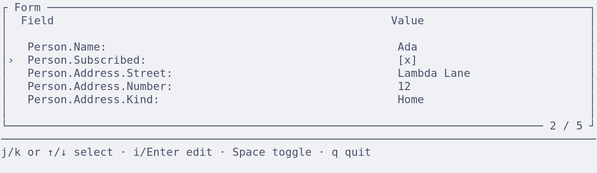

#+title: Typed forms using dependent types
#+subtitle: Session 2: Records and conditional visibility
#+author: Jan Mas Rovira
#+date:
#+options: toc:nil num:nil H:1
#+latex_class: beamer
#+latex_class_options: [aspectratio=169]
#+latex_compiler: xelatex
#+latex_header: \usepackage{fontspec}
#+latex_header: \usepackage{listings}
#+latex_header: \usepackage{newunicodechar}
#+latex_header: \newunicodechar{←}{\ensuremath{\leftarrow}}
#+latex_header: \newunicodechar{⇒}{\ensuremath{\Rightarrow}}
#+latex_header: \newunicodechar{→}{\ensuremath{\rightarrow}}
#+latex_header: \newunicodechar{⟶}{\ensuremath{\longrightarrow}}
#+latex_header: \newunicodechar{⟨}{\ensuremath{\langle}}
#+latex_header: \newunicodechar{⟩}{\ensuremath{\rangle}}
#+latex_header: \newunicodechar{≤}{\ensuremath{\leq}}
#+latex_header: \newunicodechar{∧}{\ensuremath{\land}}
#+latex_header: \newunicodechar{α}{\ensuremath{\alpha}}
#+latex_header: \newunicodechar{τ}{\ensuremath{\tau}}
#+latex_header: \newunicodechar{≃}{\ensuremath{\simeq}}
#+latex_header: \lstset{literate={←}{{$\leftarrow$}}1 {⇒}{{$\Rightarrow$}}1 {→}{{$\rightarrow$}}1 {⟶}{{$\longrightarrow$}}2 {⟨}{{$\langle$}}1 {⟩}{{$\rangle$}}1 {≤}{{$\leq$}}1 {∧}{{$\land$}}1 {α}{{$\alpha$}}1 {≃}{{$\simeq$}}1}
#+latex_header: \definecolor{codeBackground}{HTML}{F5F7FA}
#+latex_header: \definecolor{codeBorder}{HTML}{CDD5DF}
#+latex_header: \definecolor{leanKeyword}{HTML}{3454A5}
#+latex_header: \definecolor{leanType}{HTML}{137C80}
#+latex_header: \definecolor{leanString}{HTML}{A35416}
#+latex_header: \definecolor{languageCostInherited}{HTML}{1B6B3A}
#+latex_header: \definecolor{languageCostPartial}{HTML}{7B3FA1}
#+latex_header: \definecolor{languageCostSpecific}{HTML}{A32929}
#+latex_header: \newcommand{\languageCost}[2]{#2}
#+latex_header: \newcommand{\coloredLanguageCost}[2]{\textcolor{languageCost#1}{#2}}
#+latex_header: \lstdefinelanguage{Lean}{morekeywords={def,abbrev,inductive,structure,class,where,deriving,match,with,theorem,by,decide,do,let,instance,forall},morekeywords=[2]{DataType,Widget,Form,Path,Expr,Type,Prop,Sort,Fin,String,Bool,Nat,Date,PlainDate,Json,Repr,DecidableEq,Except,Enum,FinEnum,AddressKind,AddressField},morekeywords=[3]{text,boolean,natural,date,enum,record,field,group,self,textInput,checkbox,naturalInput,dateInput,select,value,project,and,dateLe,natLe,visibleWhen},sensitive=true,morestring=[b]",morecomment=[l]{--}}
#+latex_header: \lstset{basicstyle=\ttfamily\small,keywordstyle=\color{leanKeyword}\bfseries,keywordstyle=[2]\color{leanType},keywordstyle=[3]\color{leanType},stringstyle=\color{leanString},commentstyle=\color{gray},showstringspaces=false,columns=fullflexible,keepspaces=true,breaklines=true,frame=single,rulecolor=\color{codeBorder},backgroundcolor=\color{codeBackground},framerule=0.5pt,framesep=6pt,xleftmargin=7pt,xrightmargin=7pt,aboveskip=8pt,belowskip=10pt}
#+latex_header: \setbeamertemplate{navigation symbols}{}

* Extending the language: records
#+begin_center
\large What is a record type?
#+end_center

#+begin_export latex
\vspace{0.2cm}
\begin{columns}[t,onlytextwidth]
\begin{column}{0.47\textwidth}
\begin{block}{A list of tuples}
#+end_export

- A list of ⟨String, Type⟩.

#+begin_export latex
\end{block}
\end{column}
\pause{}
\begin{column}{0.47\textwidth}
\begin{block}{Names and a map to types}
#+end_export

- A finite type =FieldName=.
- A function:
  #+begin_center
  τ : FieldName → Type
  #+end_center

#+begin_export latex
\end{block}
\end{column}
\end{columns}
\par\bigskip
#+end_export

\pause{}

The second representation is more convenient:

1. Field names are unique by construction.
2. Lookup is total: every field name has a type.

* An address record

#+begin_export latex
\vspace{0.3cm}
\begin{columns}[c,onlytextwidth]
\begin{column}{0.49\textwidth}
#+end_export

- *Street*: text.
- *Number*: a natural number.
- *Kind*: home, work or other.

#+begin_export latex
\end{column}
\begin{column}{0.44\textwidth}
{\setlength{\fboxsep}{8pt}
\fcolorbox{codeBorder}{codeBackground}{%
\begin{minipage}{0.88\linewidth}
\small
\textbf{An example address}\par\medskip
\textbf{Street:}\quad Lambda Lane\par\smallskip
\textbf{Number:}\quad 12\par\smallskip
\textbf{Kind:}\quad Home
\end{minipage}}}
\end{column}
\end{columns}
\par\medskip
#+end_export

* Name the record fields
#+attr_latex: :options basicstyle=\ttfamily\footnotesize
#+begin_src lean
inductive AddressField where
  | street
  | number
  | kind

instance : FinEnum AddressField := ..

def addressFields : Enum where
  type := AddressField
  label
    | .street => "street"
    | .number => "number"
    | .kind => "kind"
#+end_src

* Type the record fields
#+attr_latex: :options basicstyle=\ttfamily\footnotesize
#+begin_src lean
abbrev address : DataType := .record addressFields fun
  | .street => .text
  | .number => .natural
  | .kind => addressKind

def initialAddress : DataType.denote address
  | .street => "Lambda Lane"
  | .number => 12
  | .kind => .home
#+end_src

* Extend DataType with records

#+attr_latex: :options basicstyle=\ttfamily\scriptsize
#+begin_src lean
inductive DataType where
  | text
  | boolean
  | natural
  | date
  | enum (domain : Enum)
  | record (fieldNames : Enum) (fieldTypes : fieldNames → DataType)

abbrev DataType.denote (type : DataType) : Type :=
  match type with
  | .text => String
  | .boolean => Bool
  | .natural => Nat
  | .date => Date
  | .enum domain => domain.type
  | .record fieldNames fieldTypes => (i : fieldNames) → DataType.denote (fieldTypes i)
#+end_src

* Extend Form with groups
#+attr_latex: :options basicstyle=\ttfamily\footnotesize
#+begin_src lean
inductive Form (root : DataType) : (type : DataType) → Type 1 where
  | field {t : DataType} (label : String) (widget : Widget t) : Form root t
  | group
      {fieldNames : Enum}
      {fieldTypes : fieldNames → DataType}
      (label : String)
      (forms : (i : fieldNames) → Form root (fieldTypes i))
      : Form root (.record fieldNames fieldTypes)
#+end_src

* A group for the address record
#+begin_src lean
def addressForm : Form address address :=
  .group "Address" fun
    | .street => .field "Street" .textInput
    | .number => .field "Number" .naturalInput
    | .kind => .field "Kind" .select
#+end_src

\pause{}

* Live demo: record fields
:properties:
:beamer_opt: fragile
:end:
#+begin_export latex
\begin{lstlisting}
$ forms person
\end{lstlisting}
#+end_export

* Conditional visibility
#+attr_latex: :width 0.95\textwidth

\pause{}

We want to show =Street= only while =Subscribed= is checked.

\pause{}

The visibility condition needs to read another field's *current value*.

* A condition needs a field reference
The =person= type description defines these fields:

#+attr_latex: :options basicstyle=\ttfamily\footnotesize
#+begin_src lean
abbrev person : DataType := .record personFields fun
  | .name => .text
  | .subscribed => .boolean
  | .address => address
#+end_src

\pause{}

The condition needs a reference from the whole person record to its =Bool= field.

A *path* represents that reference. Its type records where it starts and the
type of value it reaches: =Path person .boolean=.

* Paths identify fields with their types
#+attr_latex: :options basicstyle=\ttfamily\footnotesize,aboveskip=5pt,belowskip=5pt
#+begin_src lean
inductive Path : (root : DataType) → (target : DataType) → Type 1 where
  | self {type : DataType} : Path type type
  | field
      {fieldNames : Enum}
      {fieldTypes : fieldNames → DataType}
      {target : DataType}
      (fieldName : fieldNames)
      (rest : Path (fieldTypes fieldName) target)
      : Path (.record fieldNames fieldTypes) target
#+end_src

\pause{}

#+attr_latex: :options basicstyle=\ttfamily\footnotesize,aboveskip=5pt,belowskip=5pt
#+begin_src lean
def subscribed : Path person .boolean := .field .subscribed .self
#+end_src

* Read the field's current value
=initial= is the person value from the demo, with =Subscribed= initially =false=.

#+begin_src lean
#eval Path.get subscribed initial -- false

def subscribedPerson : DataType.denote person :=
  Path.set subscribed true initial

#eval Path.get subscribed subscribedPerson -- true
#+end_src

\pause{}

The same reference reads the checkbox's value as the person record changes.
The visibility condition can use this reference whenever it is evaluated.

* Describe the visibility condition
A =Path= identifies a field. An =Expr= describes a computation using the form's
current value.

#+begin_src lean
def isSubscribed : Expr person .boolean :=
  .project subscribed
#+end_src

=.project= reads the value at the path.

\pause{}

#+begin_src lean
#eval Expr.eval isSubscribed initial -- false
#eval Expr.eval isSubscribed subscribedPerson -- true
#+end_src

* Expressions have typed inputs and results
#+attr_latex: :options basicstyle=\ttfamily\footnotesize
#+begin_src lean
inductive Expr (root : DataType) : (result : DataType) → Type 1 where
  | value {t : DataType} (v : DataType.denote t) : Expr root t
  | project {t : DataType} (p : Path root t) : Expr root t
  | and (l r : Expr root .boolean) : Expr root .boolean
  | dateLe (l r : Expr root .date) : Expr root .boolean
  | natLe (l r : Expr root .natural) : Expr root .boolean
#+end_src

\pause{}

=root= describes the form value available to the expression. The result index
determines the type it computes.

Lean checks that each operation receives expressions of the required types.

* Send the condition to the client
:properties:
:beamer_opt: fragile
:end:
The Rust client needs to evaluate the condition after user edits.

The expression =.project subscribed= serializes as:

#+begin_export latex
\begin{lstlisting}
{
  "kind": "project",
  "path": ["subscribed"]
}
\end{lstlisting}
#+end_export

\pause{}

Rust interprets this description against the current person value when
determining which fields to show.

* Extend Form with conditional visibility
Add a constructor to =Form=:

#+begin_src lean
| visibleWhen
    {t : DataType}
    (condition : Expr root .boolean)
    (body : Form root t)
    : Form root t
#+end_src

\pause{}

- The condition must compute a =Bool=.
- The wrapped form still edits a value of type =t=.
- Both have access to the same =root= context.

* A nested field can read the whole person
#+begin_src lean
def streetForm : Form person .text :=
  .visibleWhen isSubscribed
    (.field "Street" .textInput)
#+end_src

\pause{}

- =person= describes the whole person record, including =Subscribed=.
- =.text= is the value edited by the street widget.

The condition can therefore read a field outside the address group.

* Use the condition inside the address group
#+attr_latex: :options basicstyle=\ttfamily\footnotesize
#+begin_src lean
def personForm : Form person person :=
  .group "Person" fun
    | .name => .field "Name" .textInput
    | .subscribed => .field "Subscribed" .checkbox
    | .address => .group "Address" fun
      | .street => streetForm
      | .number => .visibleWhen isSubscribed
          (.field "Number" .naturalInput)
      | .kind => .field "Kind" .select
#+end_src

The street and number widgets share the same condition. The kind selector is
always shown.

* Hidden fields keep their values
The record retains hidden fields and their last edited values.

| Action         | Street shown? | Stored street |
|----------------+---------------+---------------|
| Start          | No            | Lambda Lane   |
| Check and edit | Yes           | New Street    |
| Uncheck        | No            | New Street    |
| Check again    | Yes           | New Street    |

\pause{}

The result still contains the full person record, including the address fields.

* Live demo: conditional visibility
:properties:
:beamer_opt: fragile
:end:
#+begin_export latex
\begin{lstlisting}
$ forms person
\end{lstlisting}
#+end_export

1. Toggle =Subscribed= to show the street and number widgets.
2. Edit one of those fields.
3. Toggle =Subscribed= off and on again; the edited value is retained.
4. Quit and inspect the returned person record.
